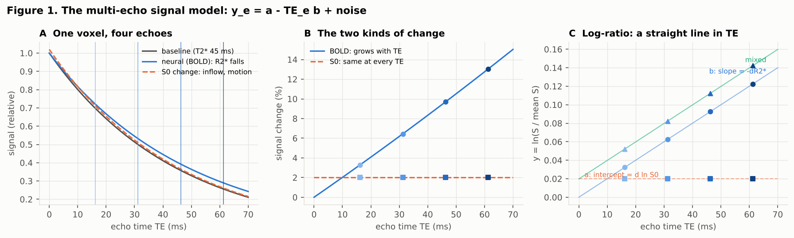
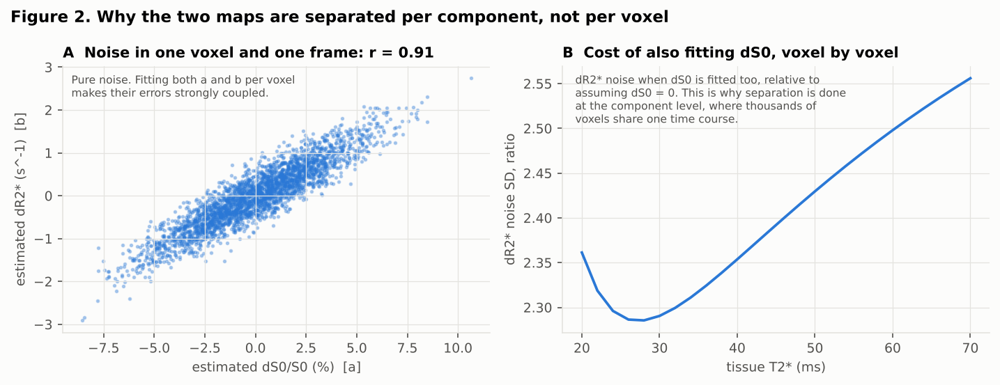
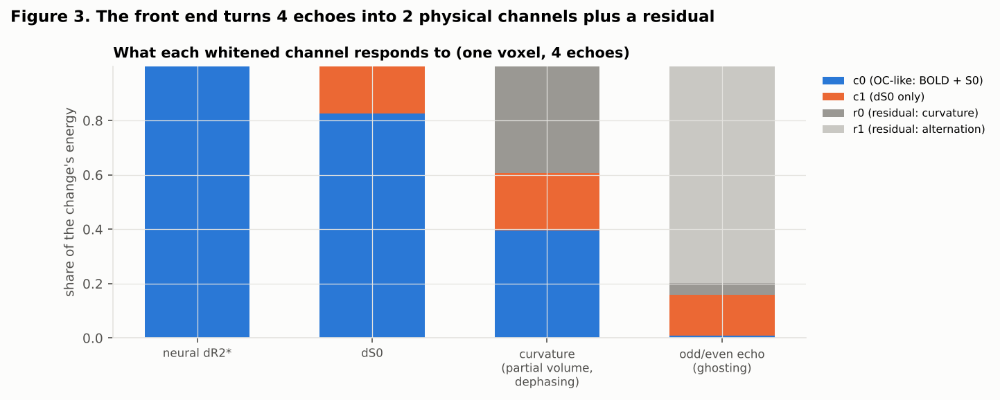
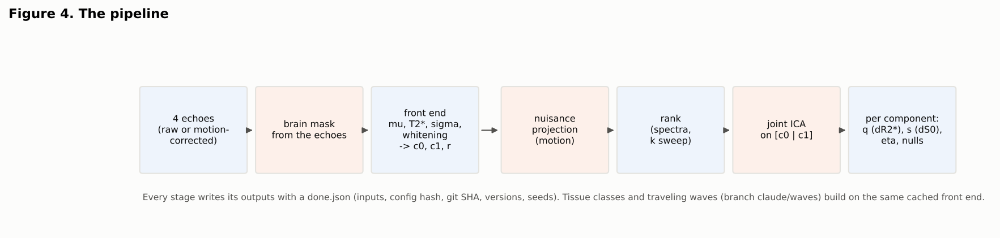
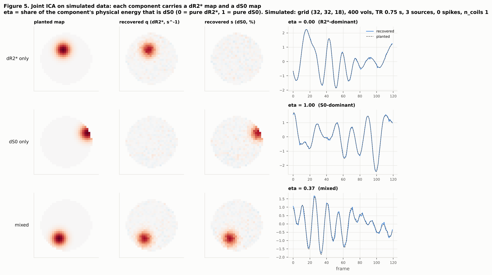
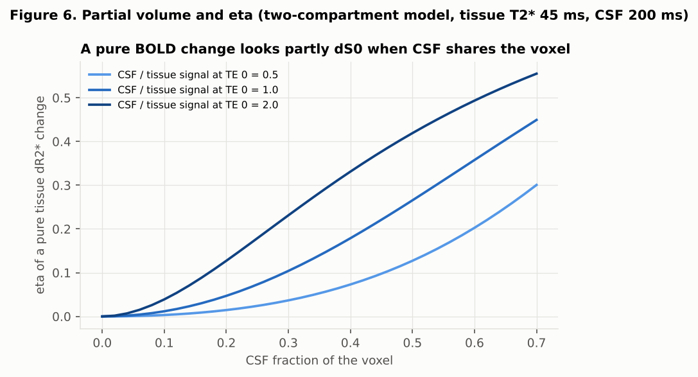

# fMRI-Decomp (`mejoint`)

Physics-constrained decomposition of multi-echo resting-state fMRI. Every component carries **two maps**:
a ΔR2\* map (the BOLD-like, echo-time-dependent part) and a ΔS0 map (the echo-time-independent part:
inflow, motion, some vascular effects), estimated **during** the decomposition.

The standing design brief is [`CLAUDE.md`](CLAUDE.md). Every decision, gate and real-data result, with
its evidence, is in [`docs/decisions.md`](docs/decisions.md). The literature review is
[`docs/research_report.md`](docs/research_report.md).

---

## 1. The problem

A BOLD fMRI voxel's signal changes for many reasons. Only some of them are neural:

- the **neural / hemodynamic** part changes the tissue's apparent transverse relaxation rate **R2\***
  (more oxygenated blood means a lower R2\* and a slower signal decay);
- head motion, inflow of fresh blood, and some vascular and CSF effects change the signal's
  **starting amplitude S0**, the signal the voxel would give at an echo time of zero.

With one echo, the two are mixed in a single number per frame. **Multi-echo** fMRI records the same
frame at several echo times (here 4: 16.2, 31.2, 46.2 and 61.3 ms). Because the two kinds of change
behave differently across echo times (Figure 1), they can in principle be told apart.



*Figure 1. A: one voxel's signal decays with echo time. B: a neural (BOLD) change grows with echo time;
an S0 change is the same percentage at every echo. C: on a log scale both become straight lines in echo
time. The intercept a is the S0 change, the slope b is the R2\* change, and a mixture is the sum.*

**How it is usually done.** The standard tool, tedana (ME-ICA), first decomposes an optimally combined
image with ICA. It then *classifies* each component afterwards: it measures how well the component's
echo dependence fits a pure-R2\* model (kappa) or a pure-S0 model (rho), and accepts or rejects the whole
component. This has two limits:
- a component that is partly both (expected for real physiology at 3 T and a short TR) has to be forced
  into one class;
- the ΔS0 and ΔR2\* parts are never estimated as maps in their own right.

## 2. The approach

1. **Turn the four echoes into two physical channels per voxel, plus a check.** A per-voxel weighted fit of
   the log-signal against `[1, -TE]` is rewritten in an orthonormal basis (a QR factorization) that makes
   the thermal noise white:
   - **c0** carries both kinds of change and is nearly the optimally combined signal tedana uses;
   - **c1** responds **only** to S0 changes;
   - the **residual** (r0, r1) responds only to what the model cannot explain (curvature in the decay,
     odd/even echo artefacts) and gives an internal noise reference (Figure 3).
2. **Do not separate S0 from R2\* voxel by voxel.** In one voxel and one frame the two estimates are
   noisy and strongly coupled (r ≈ 0.9; Figure 2A). The R2\* noise is 2.2-2.6 times larger than if S0
   were assumed constant (Figure 2B).
3. **Separate them at the component level instead.** One joint spatial ICA runs on c0 and c1 stacked
   together, so each component has **one shared time course** pooled over thousands of voxels. Its two
   channel maps are then converted exactly back into a ΔS0 map **s** and a ΔR2\* map **q**.
4. **Measure, do not classify.** For each component, **η** is the share of its physical signal energy
   that is ΔS0, with the expected noise removed. 0 means pure ΔR2\*, 1 pure ΔS0, and values in between
   are mixtures (Figure 5).



*Figure 2. A: with 4 echoes, the per-voxel estimates of the S0 change (a) and the R2\* change (b) share
most of their noise. B: fitting S0 as well multiplies the R2\* noise by 2.3-2.6 over the T2\* range of
brain tissue. Pooling over a component's voxels is what pays this cost back.*



*Figure 3. What each channel sees, for four kinds of change in one voxel (computed with the package's
own projection). A neural ΔR2\* change appears only in c0. A ΔS0 change appears in both c0 and c1, and c1
isolates it. Decay curvature (partial volume, through-slice dephasing) and odd/even-echo patterns
(ghosting) reach the residual, but only for the part outside the straight-line model: a small residual
does not certify a clean ΔR2\*.*





*Figure 5. Simulated data with three planted sources (ΔR2\* only, ΔS0 only, mixed). The joint ICA
recovers each one's time course and both of its maps; η places each where it belongs.*

## 3. The quantities, defined intuitively

| Symbol | What it is | Intuition |
|---|---|---|
| TE | echo time | how long after excitation the signal is read; later echoes are more sensitive to R2\* |
| S0 | signal at TE = 0 | how much signal the voxel would give with no decay: proton density, coil sensitivity, inflow |
| T2\*, R2\* = 1/T2\* | decay time / rate | how fast the signal fades; BOLD lowers R2\* slightly |
| μ_e | temporal mean signal at echo e | the voxel's average decay curve |
| y_e(t) | ln(S_e(t)) minus its temporal mean | the frame's change on a log scale, exactly linear in a and b |
| a(t), b(t) | Δln S0 and ΔR2\* in one frame | intercept and slope of y against TE (Figure 1C) |
| σ_v | thermal noise of echo 1 in voxel v | the scanner's electronic noise, estimated from the residual, never from the data's own fluctuation |
| r_e | per-echo noise ratios | thermal noise of echo e relative to echo 1; measured as [1, 0.721, 0.631, 0.560] in this protocol |
| c0, c1 | whitened physical channels | c0: BOLD + S0 (OC-like); c1: S0 only; unit thermal noise |
| r0, r1 | residual channels | what the 2-parameter model cannot explain: curvature, alternation; a thermal-noise reference |
| R00, R01, R11 | per-voxel QR factors | translate channel units back into physical units; R11 small means S0 is poorly measured there |
| k | number of components | no single value is defensible for these data (section 5), so results are reported across a sweep |
| m0, m1 | a component's channel maps | how strongly each voxel's c0 and c1 follow the component's time course |
| s, q | a component's ΔS0 map (fraction) and ΔR2\* map (s⁻¹) | the physical maps: `s = m1 / R11`, `q = (m0 - R01 s) / R00` |
| E_S0, E_R2 | physical energies | how much of the component is S0 and how much R2\*, with the expected noise subtracted |
| η | E_S0 / (E_S0 + E_R2) | 0 = pure ΔR2\*, 1 = pure ΔS0; a measurement, never by itself a "noise" label |
| f_long, κ | long-T2\* (CSF-like) fraction of a voxel; partial-volume coupling | a CSF-sharing voxel makes pure BOLD look partly ΔS0 (Figure 6); κ predicts how much |
| FD, drift | frame-to-frame head motion; distance from the median head position | motion summaries from the motion correction; FD is computed after removing the breathing band |



*Figure 6. When CSF (long T2\*) shares a voxel with tissue, a pure tissue ΔR2\* change no longer gives a
straight line in TE, and part of it is read as ΔS0, with the same sign as the signal change (opposite in
sign to ΔR2\*). With 3.3 mm
voxels at cortical and ventricular borders this is common, so η must be read together with each
voxel's CSF fraction.*

## 4. Pipeline stages

| Stage | What it does | Command (repository root) |
|---|---|---|
| Whole pipeline, all participants | mbme_tedana (`--keep-intermediates`), front ends, tissue, rank (MAPCA), waves, joint-ICA sweep; one LSF job per participant | `bash scripts/submit_pipeline_batch.sh <echo-1 list>` |
| Audit | inventories echoes, sidecars and pipeline outputs | `scripts/phase0_one_subject.lsf`, `scripts/phase0_all_subjects.lsf` |
| Mask | brain mask from the echoes themselves (holes filled; cerebellum and orbitofrontal cortex kept) | inside the front end; QC: `mejoint mask-qc` |
| Front end | mean decay, T2\*, thermal σ, echo usability, whitening into c0, c1, r | `scripts/phase2_frontend_subject.lsf "<run>" mc auto reg` |
| Nuisance | one projection of filtered motion regressors (24 terms) applied to all channels | part of the front end (`reg` / `noreg`) |
| Rank | spectra and every dimensionality estimate, reported | `mejoint rank --frontend-dir ... --out ...` |
| Tissue (data-only) | two-compartment fit of the mean decay: CSF fraction, classes, κ | `mejoint tissue --frontend-dir ... --out ...` |
| Joint ICA + metrics | components, s and q maps, η, nulls, bootstrap intervals, stability, figures | `scripts/phase4_subject.lsf "<front-end folder>" "<rank folder>"` |
| Traveling waves (branch `claude/waves`) | complex modes of the band-passed analytic channels: lag maps, speed and direction, η, TE-dependent lag, two figures per mode | `mejoint waves --frontend-dir ... --out ...`, or `mejoint decompose ... --waves --wave-figures`; overnight: `scripts/waves_overnight.lsf "<run>"`; all participants: `scripts/submit_waves_batch.sh runs.txt` |

The motion-corrected echoes come from the existing `mbme_tedana.py` pipeline (pairing of volumes across
echoes and motion correction are reused, not reimplemented). Each stage writes a `done.json` (input
hashes, configuration hash, git commit, package versions, seeds). Every tunable is in
[`configs/default.yaml`](configs/default.yaml), and a copy goes into every output folder.

**Running code.** Nothing is installed. Job scripts call the project environment's python by full path
and set `PYTHONPATH=src`:

```bash
PYTHONPATH=src ~/miniconda3_new/envs/mejoint/bin/python -m mejoint.cli --help
```

Tests (synthetic data, CPU, a few minutes without the slow set):

```bash
PYTHONPATH=src ~/miniconda3_new/envs/mejoint/bin/python -m pytest -m "not slow"
```

The README figures are regenerated from the package's own code:

```bash
PYTHONPATH=src ~/miniconda3_new/envs/mejoint/bin/python scripts/make_readme_figures.py
```

## 5. What has been established, and what has not

Defensible so far (details and numbers in `docs/decisions.md`):
- **Noise is not equal across echoes** in this protocol: echo 1 is the noisiest in 14 of 15 runs.
  The whitening uses per-echo weights.
- **Thermal σ** comes from frame-to-frame differences of the residual, because slow, motion-paced decay
  changes inflate the plain estimate. Its echo-to-echo shape agrees with an independent MP-PCA estimate
  within 7 %. Its overall level is about 20 % above MP-PCA's, which is accepted and reported as a
  limitation.
- **Motion regression** removes about half of c0's energy on the pilot subject; about a quarter would
  be removed by any regressors with the same frequency content. A no-regression variant is always
  available for comparison.
- **There is no single defensible number of components.** Every phase-randomized estimator either
  under-counts or runs to its limit, because the noise is coloured and varies in level over time. Results
  are reported across a fixed sweep (the MAPCA estimates and 50, 70, 90).
- **The joint ICA** recovers planted ΔR2\*, ΔS0 and mixed sources in simulation (time courses and maps
  |r| > 0.96), reproduces tedana's optimally combined decomposition exactly as a special case, and is
  stable across 30 restarts on real data.

Open, and stated plainly:
- On real data the surrogate significance test and the η labels carry little information yet. Every
  component passes, and the thermal-noise bands are too narrow. Injection of known signals into the raw
  echoes (Phase 5) will provide the real-data reference.
- On the pilot subject, η is about 0.2 for the most BOLD-like components. Partial volume with CSF alone
  can explain that (Figure 6), so it is not evidence of physiological ΔS0.
- No physiological recordings exist, so breathing- and arousal-related signals are handled from the data
  alone.
- To our knowledge (literature review, `CLAUDE.md` section 13) no published method estimates separate
  ΔS0 and ΔR2\* maps during the decomposition; two sources must still be checked before any novelty claim.

## 6. Repository map

```
src/mejoint/      io, inventory, simulate, mask, frontend, nuisance, rank, tissue, decompose, metrics, cli
scripts/          LSF job scripts (*.lsf) and figure scripts (plot_*.py, make_readme_figures.py)
tests/            pytest: simulations with known ground truth for every stage
configs/          default.yaml: every tunable
docs/             decisions.md (gates, results), research_report.md, WAVES_BRIEF.md, figures/
```

**Branches.**
- `claude/beautiful-hamilton-141ubf` is the project branch (all phases).
- `claude/waves` holds the traveling-wave extension ([`docs/WAVES_BRIEF.md`](docs/WAVES_BRIEF.md)): complex,
  analytic-signal modes with complex ΔR2\* and ΔS0 maps, run as an option of the decomposition, plus a
  separate group command.
- Nothing is merged into `main` without the user's agreement.
